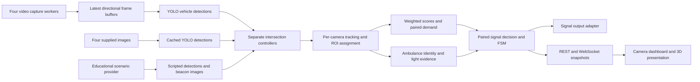

# DHAARA system architecture

This is the current implementation, not a deployment specification. Last reviewed: 2026-10-13. `changes.md` records completed fixes and verification.

## Components and ownership

DHAARA consists of a FastAPI Python backend and a Next.js/React TypeScript frontend. OpenCV handles frame ingestion, image operations and annotations. YOLO provides vehicle detections; deterministic tracking, scoring and signal control consume those detections. Three.js renders the educational city.

`backend/app/main.py` creates the application, registers routes, initializes SQLite/SQLAlchemy, seeds the initial administrator when needed, registers runtimes and starts background workers. `core/config.py` reads environment settings; `core/domain_config.py` supplies typed domain values. Relative video and image paths resolve against `backend/`.

| Runtime | Source and purpose | Clock | Storage |
| --- | --- | --- | --- |
| Live intersection, initially `OD-BBSR-001` | Four independent directional videos; missing sources stay offline | Monotonic signal clock | Live database snapshots, decisions and events; bounded memory records |
| `IMAGE-DEMO` | Real YOLO detections on the four files in `backend/images`; each EW or NS pair shares one photograph | Pausable, accelerated demonstration clock | Session memory only |
| `SIMULATION-LAB` | Scripted detections and generated beacon pixels for educational cases | Pausable, accelerated demonstration clock | Session memory only |

`core/state.py` owns registered runtimes. Each runtime contains a controller, source buffers, processed images, output adapter and lock. Its lock serializes control requests and processing. Educational runtimes are excluded from regional coordination and live persistence. `SimulationSignalController` currently records signal outputs in memory; the project does not drive physical traffic-signal hardware.

## Processing flow

Live capture workers maintain one latest-frame buffer per direction. The controller loop processes available fresh frames and broadcasts approximately every 0.2 seconds, subject to processing time. A shared YOLO batch processes the available directional images. There is no replacement footage or synthetic fallback for an offline live source.

`services/controllers/intersection_controller.py` owns the pipeline. Each camera has an independent tracker and ROI assigner, with globally distinct track IDs within the intersection. Only current detections whose bounding-box centers are inside the polygon contribute to scores; retained but missed tracks do not count. Ambulance priority can inspect the entire directional image independently of the counting polygon. Helmet analysis remains a separate diagnostic feature.

## Signal rules

`services/decision/vehicle_scoring.py` assigns car/bus/truck/ambulance weight 2, auto/rickshaw weight 1.5 and motorcycle/bicycle weight 1. Labels are normalized before scoring. Standard COCO YOLO does not recognize auto-rickshaws separately; the frontend reports that limitation.

Each direction has a weighted sum. `EW = (E + W) / 2`; `NS = (N + S) / 2`. Pair scores and the denser pair are recorded. The paired FSM in `services/signals/signal_fsm.py` is the sole owner of output colours, active pair, pending pair, elapsed time, previous phase and full-phase protection.

- Normal operation alternates 70 seconds of green between EW and NS.
- Every change uses 3 seconds of yellow on the outgoing pair while the other pair stays red. The receiving pair's green timer starts after yellow finishes.
- An initial score lead of at least 20 points can select the first pair. Normal alternation prevents repeated green for the same dense pair.
- Early switching requires complete inputs, a green pair score at most 5 for 3 seconds, an opposing lead of at least 20 and more than 20 seconds of green remaining.
- An early receiving pair is protected for its complete 70-second green phase against another demand-based cut. Emergency priority remains available.
- Missing input disables demand-based early switching; it is not scored as an empty road.
- Manual and emergency changes also use yellow. Repeated requests do not restart yellow. A withdrawn pending emergency completes clearance before restoring the prior clock.

`ADAPTIVE`, `FIXED` and `MANUAL` modes use the same paired output model. The decision engine supplies requests; it does not write light colours directly.

## Ambulance evidence

`cv/ambulance_detector.py` recognizes custom ambulance labels or supplies a colour-feature candidate from vehicle crops. This heuristic is not a validated production ambulance classifier. `emergency/ambulance_confirmation.py` requires repeated qualifying identity observations. `cv/emergency_lights.py` tracks temporal roof-beacon on/off changes; a steady light bar or body marking alone does not establish flashing. `emergency_manager.py` owns detection, request, active priority and resolution states.

The image demo uses explicitly labelled demo light input because a still photo cannot establish temporal flashing. The 3D lab generates beacon pixels for the existing temporal detector. Neither classroom control can request priority on the live intersection. Signal priority still waits for required identity evidence and yellow clearance.

Selecting or swapping into the ambulance image preset supplies a 12-virtual-second lights-ON demonstration immediately. Lights OFF and repeat-ON controls remain available, and the camera overlay identifies the input independently of the static pixels. A paused clock pauses repeated confirmation observations and yellow clearance. Image-demo OFF releases its known explicit priority on that observation. Lab OFF clears temporal beacon history so previously observed flashes cannot justify a pending emergency after an explicit OFF command; normal video tolerance is unchanged.

## Educational runtimes and presentation

`services/image_demo.py` loads the four named source files, caches inference by detector, source file metadata and confidence, and creates six EW/NS-swappable combinations. Case changes retain signal history and clock. Auto tour advances after a completed yellow-to-green exchange. It has separate pause, speed and light controls. Source changes refresh cached counts and frames even while paused, without advancing virtual time. The sample ROI is uncalibrated; still images cannot measure movement, queue clearance or a physical 30-foot boundary. ROI mutation routes reject educational runtimes before writing database rows.

`services/simulation/lab.py` owns the five presets, counts, resets, virtual time and scripted ambulance. It uses the same controller pipeline, with a separate detector and scenario provider. `frontend/src/components/simulation/IntersectionScene.tsx` renders car queues and existing crossing-clearance protection. `sceneVisuals.ts` supplies geometry, materials, lighting and disposal. Lighting, camera and fullscreen controls are presentation-only. The scene is illustrative; scripted demand is replenished rather than presented as measurement. Signal controls remain available if WebGL fails.

Lab ambulance commands process a zero-duration observation before responding, including while paused. Same-direction light changes preserve script identity and update the existing ambulance; changing direction replaces it. Beacon changes do not rebuild the visual queues. The controller still confirms identity and temporal flashes before priority.

## Interfaces and frontend state

`frontend/src/lib/api.ts` centralizes REST URLs and bearer tokens. `auth.tsx` provides login/role state; `intersectionContext.tsx` loads inputs and remembers selection. The image demo is preferred when configured video files are missing. `useIntersectionSocket.ts` subscribes by runtime ID, reconnects and marks stalled streams stale.

REST and WebSocket payloads expose source provenance, lane counts/classes/scores, pair averages, decisions, signal maps, emergency status and score records. `api/websocket.py` constructs snapshots. Frontend signal components display this backend state; the 3D renderer does not compute traffic priority.

Each educational runtime exposes an immutable `session_id`. Frontend revision/run ordering applies within that session, so a backend restart can replace old UI state despite lower counters. A new lab session also rebuilds the rendered vehicles. No personal or persisted identity is stored in these identifiers.

| Interface | Purpose |
| --- | --- |
| `/api/auth/login`, `/api/auth/me` | Authentication and current user |
| `/api/intersections`, `/api/intersections/{id}/traffic`, `/api/intersections/{id}/signal` | Inputs and runtime state |
| `/api/video/frame`, `/api/video/status`, `/api/video/upload`, `/api/video/start`, `/api/video/stop` | Annotated frames and live video management |
| `/api/intersections/{id}/lanes` | Directional ROI configuration |
| `/api/image-demo`, `/api/image-demo/case`, `/api/image-demo/control` | Isolated image demonstration |
| `/api/simulation/state`, `/api/simulation/scenario`, `/api/simulation/control`, `/api/simulation/reset`, `/api/simulation/ambulance` | Isolated 3D lab |
| `/ws/intersections/{id}` | Runtime snapshot stream |
| `/api/config`, `/api/health` | Live settings and health |
| `/api/events`, `/api/emergency`, `/api/safety`, `/api/analytics`, `/api/classifier` | Existing event, diagnostic, analytics and image-classifier interfaces |

Authenticated viewers may operate educational controls. Live signal/video mutations require operator or administrator permissions; ROI and system configuration require administrators. See route dependencies for exact enforcement. Local REST authentication is implemented, but frame and WebSocket read access requires review before exposing the service beyond its intended local demonstration environment.

## Persistence, failures and limitations

SQLAlchemy models under `models/` describe users, intersections, lanes, camera metadata, traffic snapshots, signal decisions, safety/emergency records and system events. The event subscriber writes live events; analytics periodically writes live snapshots and decisions. Educational IDs are explicitly excluded. Structured score history is read from memory for the image demo and persisted live decision events for live inputs. Configuration changes apply to running live controllers and are logged; they are not written back to `.env`.

Live inputs, the image demo and the image-classifier service reuse the same YOLO detector instance. Updating its confidence through live configuration also invalidates the image detection cache. Signal timings/controllers remain separate; model calibration is shared in the current implementation.

Unavailable video frames return HTTP 503. A processing failure clears the affected processed images/snapshot and broadcasts an error rather than displaying invented measurements. Source recovery is retried by capture/processing workers. GPU/WebGL failure leaves textual controls usable. External road calibration, custom rickshaw/ambulance model validation and real camera flashing-light validation remain outside what the still-image and scripted demonstrations prove.

## Verification and maintenance

Backend regression tests are in `backend/app/tests`. Use isolated databases and `.pytest_cache` temporary directories. TypeScript, production build and browser checks cover frontend work. `AGENTS.md` establishes maintenance rules, `README.md` covers operation, and `changes.md` records the changes and actual checks. Update this design when state ownership, interfaces, timing, sources or persistence changes.
